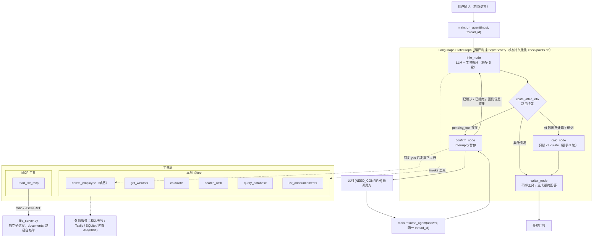

# multi-tool-agent

[](https://github.com/wutangxuelili/multi-tool-agent/actions/workflows/test.yml)

[](LICENSE)

> **TL;DR (English)** — A LangGraph-orchestrated multi-tool AI assistant (weather / calculator / web search / SQLite company DB / internal API / MCP file reader).
> Deleting an employee is a **sensitive operation**: the LLM cannot execute it — the graph interrupts, a human must confirm, and every approval/rejection is audited (JSONL + archive table with operator).
> Runs on a **zero-secret CI**: 106 tests, 80% coverage, `ruff` clean — LLM is lazily created and injected as a fake in tests.
> Full documentation below is in Chinese.

## 项目简介

一个用 **LangGraph** 编排的多工具 AI 助手：用自然语言提问，由 LLM 自主选择并调用天气、搜索、公司数据库、内部公告和 MCP 文件读取等工具，最后汇总成中文回答；**删除类敏感操作会强制暂停，等待人工确认后才执行**。

核心能力：

- **7 个工具**（6 个本地 `@tool` + 1 个 MCP 工具）：天气 / 计算 / 联网搜索 / 公司数据库 / 内部公告 API / 员工删除 / 文件读取
- **LangGraph StateGraph 编排**：`info → (calc)? → writer` 主链路，外加 `confirm` 敏感操作分支，取代传统的单 Agent ReAct 循环
- **MCP 协议接入**：文件读取走独立的 MCP Server（stdio / JSON-RPC），路径白名单在 Server 侧强制校验
- **权限控制**：基于 LangGraph `interrupt()` + SQLite checkpointer 实现"暂停—人工确认—跨进程恢复"
- **多轮工具循环**：`info_node` 最多 5 轮、`calc_node` 最多 3 轮，避免无限调用

## 架构图



## 工具列表

工具在 `tools/__init__.py` 中汇总为 `ALL_TOOLS`，并额外建立 `TOOL_MAP`（工具名 → 工具对象）供节点按名调用。

| 工具名 | 类型 | 用途 | 是否敏感 |
|---|---|---|---|
| `get_weather` | 本地 `@tool`（和风天气 HTTP API） | 查询指定城市的当前天气 | 否 |
| `calculate` | 本地 `@tool`（simpleeval） | 计算数学表达式，支持加减乘除、幂运算和括号 | 否 |
| `search_web` | 本地 `@tool`（Tavily） | 搜索互联网，返回与关键词相关的摘要 | 否 |
| `query_database` | 本地 `@tool`（SQLite 只读连接） | 查询公司数据库，返回员工信息；只允许 `SELECT`，最多返回 20 行，**薪资等敏感列默认脱敏为 `***`** | 否 |
| `delete_employee` | 本地 `@tool`（SQLite 写入） | 删除指定 ID 的员工（**先归档到 `deleted_employees` 再删除**，含删除时间与操作人） | **是** |
| `list_announcements` | 本地 `@tool`（内部 API HTTP） | 查询公司内部公告，可按分类过滤（活动/运维/培训/财务） | 否 |
| `read_file_mcp` | **MCP 工具**（stdio → `file_server`） | 通过 MCP 协议读取 `documents/` 目录下的文件，支持 txt、md 等文本格式 | 否 |

`delete_employee` 的敏感性由 `tools/__init__.py` 中的 `SENSITIVE_TOOL_NAMES = frozenset({"delete_employee"})` 登记——命中该集合的 `tool_call` 不会被直接执行，而是交给 `confirm_node`；执行层（`agent/nodes.py` 的 `_execute_tool`）也会拒绝未确认的敏感工具，双保险。新增危险工具时忘记登记，`tests/test_sensitive_gate.py` 会失败。

## Agent 架构选型

### 为什么用 LangGraph 而不是 AgentExecutor

| 需求 | AgentExecutor | LangGraph StateGraph |
|---|---|---|
| 工具执行前暂停、等人工确认 | 只能在回调里中断，状态无法跨进程保存 | `interrupt()` 原生暂停，状态由 checkpointer 落盘 |
| 暂停后从**另一个进程**恢复 | 不支持 | `Command(resume=...)` + 相同 `thread_id` 即可恢复 |
| 不同阶段用不同工具集 | 一个 agent 只能绑一套工具 | 每个节点独立 `bind_tools` |
| 工具循环次数可控 | 靠 `max_iterations` 粗粒度限制 | 每个节点自己的 `for` 上限（5 / 3 轮） |

**取舍**：图的搭建和 state 管理比 `AgentExecutor` 重，需要自己维护 checkpointer；换来的是可恢复、可测试、每个节点能配独立的 prompt 和工具集。

### 为什么做职责分离（info / calc / writer）

三个节点绑定的工具集完全不同，这是分离的主要动机：

- `info_node` 绑 6 个信息类工具，负责"取数据"
- `calc_node` **只绑** `calculate`，避免选错工具
- `writer_node` **不绑任何工具**，只负责把已有信息写成通顺回答——它没有工具可调，因此不可能在最后一步又乱调工具

分工后每个 prompt 都很短（`agent/prompts.py` 共 47 行），职责聚焦。

**取舍**：一次问答会多出 1~2 次 LLM 调用，延迟和成本上升。更关键的是，`calc_node` 的**触发条件**曾经很脆弱——旧实现只看 **AI 自己最后一条消息**里有没有出现 `需要计算`、`帮我算` 等固定关键词，模型一句"我自己心算就行"就把整个计算器绕过去了。

**现已修正**：`route_after_info` 改为**优先判断用户提问里的算术意图**（数字+运算符、或"计算/平均/求和/换算"等表达），AI 的自述只作为补充触发条件。理由很直接——"要不要算"这件事，用户比模型可靠。回归测试见 `tests/test_agent_graph.py::test_route_uses_user_question_even_if_ai_stays_silent`。

### 为什么用 interrupt 实现敏感操作确认

关键点是：**把"要不要执行"的决定权从 LLM 手里拿走，交给代码**。

1. `info_node` 遍历 `tool_calls` 时，发现工具在 **`tools/__init__.py` 的 `SENSITIVE_TOOL_NAMES` 登记表**里，就**只记录不执行**，写入 `pending_tool`
2. `route_after_info` 看到 `pending_tool` 就路由到 `confirm_node`
3. `confirm_node` 调用 `interrupt(...)` 挂起，`run_agent` 向调用方返回 `[NEED_CONFIRM] ...`
4. 调用方回复后，`resume_agent(answer, thread_id)` 用**同一个 thread_id** 恢复
5. 答复被判定为"同意"（`yes` / `y` / `是` / `确认` / `同意`，大小写与空格无关）才真正执行，否则返回"用户取消了操作。"

这样做的好处是：**即使 LLM 被提示词说服（或被注入攻击诱导）要删除数据，只要没经过第 5 步就删不掉**。提示词里那句"你必须直接调用 `delete_employee`"只是让 LLM 正常发起请求，真正的闸门是代码。

闸门有**两道**，且都不依赖提示词：

- **执行层**（`agent/nodes.py` 的 `_execute_tool`）：敏感工具默认被拒绝，只有 `confirm_node` 走 `allow_sensitive=True` 才能执行。因此即使某个节点（例如只绑了 `calculate` 的 `calc_node`）被诱导出 `delete_employee`，也执行不了。
- **登记守卫**（`tests/test_sensitive_gate.py`）：`tools/database_admin.py` 里新增的任何工具，若忘记登记为敏感操作，测试会直接失败。

**取舍**：调用方必须持有并复用**产生中断的那条 `thread_id`**，换线程就找不到中断状态（为此 `run_agent` 的 `thread_id` 是必填参数，`resume_agent` 也会先校验该线程上确有等待确认的操作）；答复只做"同意/拒绝"二值判断，**没有超时作废与操作人身份校验**，生产环境仍需补上。**审计留痕有了**：每次批准/拒绝都会追加一行 JSON 到 `logs/sensitive_ops.jsonl`（时间、thread_id、工具、参数、决定、结果），写入失败不影响主流程。

### 为什么用 MCP 而不是纯 `@tool`

`read_file_mcp` 的能力本身用 `open()` 也能实现，选择 MCP 是为了三件事：

1. **进程隔离**：文件读取跑在独立子进程里，崩溃不影响主 Agent
2. **安全边界在 Server 侧**：`file_server.py` 以 `__file__` 推导 `documents/` 为白名单根目录，用 `Path.resolve()` + `Path.is_relative_to()` 做**真实路径**判定（而不是字符串前缀匹配），因此 `../../etc/passwd`、绝对路径、指向目录外的符号链接、以及与白名单共享前缀的兄弟目录（`../documents_evil/x`）都会被拒绝，而不是靠主进程自觉。`tests/test_file_server.py` 对这些绕过手法逐条回归。
3. **可复用**：同一个 Server 也能挂到 VS Code 等标准 MCP 客户端上，不必为每个宿主重写一遍

**取舍**：每次调用都要**启动子进程 + 协议握手**，首次调用有额外开销（实测约 1~3 秒，明显慢于本地 `@tool`）；而且 MCP Client 是异步的，在同步节点里只能用 `asyncio.run()` 桥接，在已有事件循环的环境中会冲突。

## 快速开始

### 环境准备

- **Python 3.11**（开发环境实测 3.11.7）
- 依赖分两层：**直接依赖的唯一事实来源是 `pyproject.toml`**，`requirements.txt` 是
  `pip freeze` 生成的**锁文件**（105 行，含全部间接依赖的精确版本，供 CI 与复现安装用）。

```bash
python -m venv .venv
.venv\Scripts\activate          # Windows

pip install -r requirements.txt   # 复现已验证过的版本组合（推荐）
# 或者：pip install -e ".[dev]"   # 按 pyproject.toml 的直接依赖安装，并带上 pytest
```

升级依赖后重新生成锁文件——**Windows PowerShell 必须显式指定 UTF-8**，
它的 `>` 默认写 UTF-16，会让 Git 把文件当二进制、diff 和依赖扫描全部失效：

```bash
pip freeze | Out-File -Encoding utf8 requirements.txt    # Windows PowerShell
pip freeze > requirements.txt                            # bash / zsh
```

> 锁文件保持**纯 ASCII**：pip 在没有 BOM 时按系统区域编码解码该文件，
> 中文注释会让 `pip install -r` 在 GBK 环境下直接报 `UnicodeDecodeError`。

开发环境中使用到的主要版本（供参考）：

| 包 | 版本 |
|---|---|
| langgraph | 1.2.12 |
| langgraph-checkpoint-sqlite | 3.1.1 |
| langchain-core | 1.6.6 |
| langchain-openai | 1.6.7 |
| mcp | 2.3.0 |
| fastapi | 0.142.4 |
| uvicorn | 0.54.0 |
| requests | 2.34.2 |
| python-dotenv | 1.2.3 |
| simpleeval | 1.0.8 |
| tavily-python | 0.8.4 |
| pydantic | 2.13.5 |

> ⚠️ **必须使用 MCP 2.x**。本项目依赖 mcp 的 v2 API，以下结论均在 `mcp==2.3.0` 上实测确认：
>
> - `python -c "from mcp.server import MCPServer; print('OK')"` → 输出 `OK`，实际解析到 `mcp.server.mcpserver.server.MCPServer`
> - `mcp.server.fastmcp` 在 2.x 中**只保留了一个故意抛错的占位模块**，导入会直接失败并给出迁移提示：
>   `ModuleNotFoundError: No module named 'mcp.server.fastmcp'. This is mcp 2.x, where FastMCP was renamed to MCPServer ... or pin 'mcp<2' to keep running v1 code.`
>
> `file_server.py` 用的是 `from mcp.server import MCPServer`，所以如果环境里装的是 `mcp<2`，启动 MCP Server 会立即报 `ImportError`（表现为任务 #6 / #17 读取文件全部失败）。可用 `pip show mcp` 确认版本。

### 配置 .env

在项目根目录创建 `.env`（**不要提交到版本库**），所有值用占位符替换：

```dotenv
# ---------- LLM（必填）----------
# 任意 OpenAI 兼容端点，例如 DeepSeek / 通义千问
LLM_BASE_URL=https://your-llm-endpoint/v1
LLM_API_KEY=sk-xxxxxxxxxxxxxxxx
LLM_MODEL=your-model-name

# ---------- 联网搜索（search_web 必填）----------
TAVILY_API_KEY=tvly-xxxxxxxxxxxxxxxx

# ---------- 天气（get_weather 必填）----------
HEFENG_API_HOST=your-subdomain.qweatherapi.com
HEFENG_API_KEY=xxxxxxxxxxxxxxxx

# ---------- 可选：行为开关 ----------
# 思考模式：adaptive / enabled / disabled。默认 disabled。
# DeepSeek 思考模式会返回 reasoning_content，而 ChatOpenAI 不会把它回传，
# 多轮对话会偶发 400，因此默认关闭。
LLM_THINKING=disabled
# 内部 API 地址与超时，默认 http://localhost:8001 / 10s
INTERNAL_API_BASE=http://localhost:8001
# INTERNAL_API_TIMEOUT=10
# 单次搜索返回条数，默认 3
# SEARCH_MAX_RESULTS=3
# 授权读取薪资等敏感列（默认脱敏；生产请交给权限系统）
# DB_SHOW_SALARY=1

# ---------- 可选：日志与运行时路径 ----------
# 想让日志少含个人信息（用户原文、员工姓名/薪资）可调到 WARNING
# LOG_LEVEL=INFO
# LOG_MAX_BYTES=2097152
# LOG_BACKUP_COUNT=3
# DATA_DIR=./data
# LOGS_DIR=./logs
# CHECKPOINT_DB=./checkpoints.db
# SENSITIVE_AUDIT_LOG=./logs/sensitive_ops.jsonl
```

`.env.example` 与上面一一对应，可直接 `cp .env.example .env` 后填空。

> 早年 `.env` 里还声明过 `LLM_PROVIDER`、`QWEN_BASE_URL`、`QWEN_MODEL`、`DASHSCOPE_API_KEY`，
> 但代码从不读取它们，`.env.example` 已不再包含；本地若还留着可以删掉。
>
> 缺必填项时的报错是明确的：`RuntimeError: 缺少必需的环境变量：LLM_BASE_URL, LLM_API_KEY, LLM_MODEL。请复制 .env.example 为 .env 并填写`——
> 而且**不配置也能 import 与跑测试**（LLM 是惰性创建的），CI 因此无需任何密钥。

### 初始化数据库

```bash
python scripts/init_db.py
# 输出：数据库创建完成：<仓库根>/data/company.db
```

该脚本会**重建** `employees` 表（并确保归档表 `deleted_employees` 存在），写入 7 名员工
（张三、李四、王五、赵六、孙七、周八、吴九）。数据库位置由 `utils/paths.py` 统一决定，
**不依赖当前工作目录**，可用 `COMPANY_DB_PATH` 覆盖。

> 历史文件名是拼错的 `scripts/inint_db.py`，现已正名为 `scripts/init_db.py`；
> 旧名保留为**转发入口**（运行时会提示 deprecated），下个版本移除。

> 注意：**仓库里不提交任何 `.db` 文件**（`.gitignore` 忽略了 `data/*.db`，只保留 `data/.gitkeep`）。
> 需要数据时跑一次 `python scripts/init_db.py` 即可，不依赖开发者本地残留的数据库。

### 启动内部 API

公告查询工具依赖这个服务，**必须先启动**（端口 8001）：

```bash
uvicorn internal_api.server:app --port 8001
```

它提供 3 个接口：`GET /health`、`GET /announcements?limit=&category=`、`GET /announcements/{id}`。
可用浏览器或 `curl http://localhost:8001/health` 确认返回 `{"status":"ok"}`。

### 运行 Agent

```bash
python main.py
```

`main.py` 的 `__main__` 会跑一个示例问题（查询南昌天气）并打印回答，遇到敏感操作会提示你输入确认。

作为库调用时，对外有三个函数：

```python
from main import CONFIRM_PREFIX, new_thread_id, resume_agent, run_agent

# thread_id 是**必填**参数：LangGraph 按 thread_id 隔离 checkpoint，
# 多个用户共用一个 id 会让 A 触发的待确认删除被 B 的答复执行掉。
thread_id = new_thread_id("user-42")

answer = run_agent("北京今天天气怎么样？", thread_id=thread_id)
while answer.startswith(CONFIRM_PREFIX):
    # 敏感操作，需要人工确认
    print(answer)                     # [NEED_CONFIRM] 即将执行敏感操作：...
    answer = resume_agent(input("(yes/no): "), thread_id=thread_id)  # thread_id 必须一致
print(answer)
```

`resume_agent` 会先检查该 `thread_id` 上是否真的有等待确认的操作：没有就返回
`[ERROR]` 开头的说明，而不是静默地重新跑一轮（旧实现在 thread_id 传错时就是这个表现）。

### 可选：在 VS Code 里通过 MCP 连接 file_server

`file_server.py` 是标准 stdio MCP Server，可以直接挂到 VS Code 的 `.vscode/mcp.json`：

```json
{
  "servers": {
    "file-reader": {
      "type": "stdio",
      "command": "${workspaceFolder}/.venv/Scripts/python.exe",
      "args": ["${workspaceFolder}/mcp_servers/file_server.py"],
      "cwd": "${workspaceFolder}"
    }
  }
}
```

**`cwd` 建议保留**：`file_server.py` 的白名单根目录由 `__file__` 推导，**已经不再依赖当前工作目录**（早期版本用 `os.path.abspath("documents")`，cwd 不对就会把白名单指到别处）。显式配置 `cwd` 仍然是好习惯，能保证相对路径类的调试行为可预测。（配置格式依据 [VS Code MCP configuration reference](https://code.visualstudio.com/docs/agents/reference/mcp-configuration)：`.vscode/mcp.json` 使用顶层 `servers` 对象，stdio 服务支持 `command` / `args` / `cwd`，并支持 `${workspaceFolder}` 变量。）

## 故障排查

按「报错信息 → 原因 → 解决方法」整理。以下 9 条都是本项目开发和测试过程中**真实出现过**的问题。

### 1. `ModuleNotFoundError: No module named 'mcp.server.fastmcp'`

**症状**：任务 #6 / #17（读取文件）全部失败，或直接运行 `python mcp_servers/file_server.py` 时抛错：

```text
ModuleNotFoundError: No module named 'mcp.server.fastmcp'. This is mcp 2.x,
where FastMCP was renamed to MCPServer ... or pin 'mcp<2' to keep running v1 code.
```

**原因**：环境里装的是 `mcp<2`（v1 API），而 `file_server.py` 用的是 v2 的 `from mcp.server import MCPServer`。

**解决**：

```bash
pip show mcp        # 期望 Version: 2.3.0
python -c "from mcp.server import MCPServer; print('OK')"   # 期望输出 OK
pip install -r requirements.txt    # 版本不对就按清单重装
```

### 2. `错误：无法连接内部 API（http://localhost:8001）`

**症状**：`list_announcements` 返回"请确认服务已启动"。

**原因**：内部 API 是**独立进程**，Agent 不会自动拉起它。

**解决**：

```bash
uvicorn internal_api.server:app --port 8001
curl http://localhost:8001/health     # 期望 {"status":"ok"}
```

### 3. 启动内部 API 报 `[Errno 10048] error while attempting to bind on address ('127.0.0.1', 8001)`

**原因**：端口被占用——**很可能已经有一个实例在跑**，不需要再起一个。

**解决**：先探测再决定；确实要换端口，记得同步改 `.env`：

```bash
curl http://localhost:8001/health     # 有响应 → 已在运行，直接用即可
uvicorn internal_api.server:app --port 8002
# 同时设置 INTERNAL_API_BASE=http://localhost:8002
```

> 提示：`Get-NetTCPConnection -LocalPort 8001` 在部分环境下会返回空结果，用 HTTP 探测更可靠。

### 4. 敏感操作无法恢复：`resume_agent` 像重新开了一轮对话

**原因**：`thread_id` 与首次调用不一致。中断现场是按 `thread_id` 存进 `checkpoints.db` 的，换一个 id 就找不到。

**解决**：两次调用必须是**同一个** `thread_id`：

```python
answer = run_agent("帮我删掉 ID 为 7 的员工", thread_id="t1")
if answer.startswith(CONFIRM_PREFIX):
    answer = resume_agent("yes", thread_id="t1")   # 必须是 t1，不能换
```

### 5. 偶发 400：`The 'reasoning_content' in the thinking mode must be passed back to the API`

**原因**：DeepSeek 的思考模式会返回 `reasoning_content`，而 `ChatOpenAI` 不会把它回传；一次问答里存在多次 LLM 调用时就会偶发 400，表现为某个任务直接抛异常挂掉。

**解决**：关闭思考模式（`llm_client.py` 的默认值就是关闭）：

```dotenv
LLM_THINKING=disabled
```

### 6. 读取文件报 `文件不存在 documents/test.txt`

**原因**：`read_file` 的 `path` 参数是**相对 `documents/`** 的，不是相对项目根目录。传 `documents/test.txt` 会被拼成 `documents/documents/test.txt`。

实测行为对照：

| 传入 `path` | 结果 |
|---|---|
| `test.txt` | ✅ 返回 `Hello from MCP!` |
| `documents/test.txt` | ❌ 错误：文件不存在 documents/test.txt |
| `../test.txt` | ❌ 错误：不允许访问 `../test.txt`，只能读取 documents/ 目录下的文件。 |
| `sub/../test.txt` | ✅ 归一化后仍在白名单内，正常读取 |
| `../documents_evil/x.txt` | ❌ 不允许访问（**曾经是漏网的越权读**，现已由回归测试锁死） |
| `C:\Windows\win.ini`（绝对路径） | ❌ 不允许访问 |

**解决**：只传相对 `documents/` 的路径，例如 `test.txt`。

### 7. `unable to open database file` / 找不到 `documents/`

**历史原因**：早期版本里 `tools/database.py` 的 `DB_PATH = "data/company.db"` 和 `file_server.py` 的 `ALLOWED_DIR = os.path.abspath("documents")` 都是**相对当前工作目录**解析的，换目录运行就会失效。

**现状**：两处都已经改成基于 `__file__` 推导（数据库走 `tools/db_config.py`，可用环境变量 `COMPANY_DB_PATH` 覆盖；`documents/` 白名单由 `file_server.py` 自己推导），**不再依赖 cwd**。

**仍然建议**：在项目根目录运行，并在 VS Code 里给 MCP Server 显式配置 `cwd`。
`checkpoints.db`、`logs/`、`data/` 现在也都由 `utils/paths.py` 按**仓库根目录**推导（可用 `CHECKPOINT_DB` / `LOGS_DIR` / `DATA_DIR` 覆盖），因此换目录运行不会再"写错地方"。

### 8. 查询薪资只看到 `***`

**原因**：这是**有意的数据分级**。`tools/database.py` 会把列名含 `salary` / `薪` / `工资` 的列
替换成 `***`（包括 `AVG(salary)` 这类聚合列），并在结果末尾说明。

**解决**：受控环境（例如评测脚本）可设 `DB_SHOW_SALARY=1` 授权查看；生产环境应接权限系统，
而不是靠环境变量一刀切。相关回归测试：`tests/test_database.py::test_salary_is_masked_by_default`。

### 9. `checkpoints.db` 越来越大

**原因**：LangGraph 的 SqliteSaver 每执行一步就写一个快照，且不会自动过期。

**解决**：定期清理——

```bash
python scripts/cleanup_checkpoints.py --days 7 --dry-run   # 先看会删多少
python scripts/cleanup_checkpoints.py --days 7 --vacuum    # 真删并回收空间
```

## 测试

两层测试，职责不同：

| 目录 | 内容 | 是否需要 API Key | 是否进 CI |
|---|---|---|---|
| `tests/` | 单元 + 图级回归测试（路由、多轮记忆、敏感操作闸门、路径白名单、数据库与运维脚本、密钥卫生） | **不需要**（LLM 用脚本化假对象注入） | ✅ 每次 push / PR |
| 代码检查 | `ruff check`（配置在 `pyproject.toml`），`pre-commit` 可选 | 不需要 | ✅ lint job |

```bash
pip install -r requirements-dev.txt    # 或 pip install -e ".[dev]"
pytest                                  # 不需要 .env
pytest --cov                           # 覆盖率门槛 70%（配置在 pyproject.toml）
ruff check .                           # 静态检查（CI 同样会跑）
```

**CI 做什么**：`ruff check` + Python 3.11/3.12 矩阵上跑 `pytest`，其中 3.11 附带
`--cov-fail-under=70`。CI 里**没有任何密钥**——这正是"LLM 惰性创建"带来的好处：
主链路可以被导入、被注入假 LLM、被断言。

关键回归点（都对应真实修过的缺陷，改坏了会立刻红）：

- `State.messages` 必须挂 `add_messages` reducer，否则多轮对话丢上下文；
- 触发敏感工具时**图必须中断且数据未被修改**，`yes` 之后才执行，`no` 之后不执行；
- 一轮里出现多个敏感调用时，每个 `tool_call` 都要有对应的 `ToolMessage`（否则下一次请求 400）；
- 文件读取的路径白名单必须挡住 `../documents_evil/x` 这类共享前缀的越界读；
- 薪资列默认脱敏、删除必须**先归档**（含操作人）再删；
- `tools/database_admin.py` 里新出现的工具若忘记登记为敏感操作，`test_sensitive_gate.py` 直接失败；
- 数据库路径/日志路径不依赖 cwd（换目录运行、`COMPANY_DB_PATH` 覆盖都要成立）。

> 注意：`agent/nodes.py` 的 LLM 是**惰性创建**的，因此没有 `.env` 也能 `import agent.graph`
> 并跑测试；真正缺配置时会给出"缺少必需的环境变量：LLM_BASE_URL, …"的明确报错。

### 关于端到端能力评测

2026-10-08 曾用一次性脚手架（`run_20_tasks.py`，20 个任务：单工具 / 多工具 / 敏感操作 / 边界 /
多步推理 / 综合）跑过一次能力评测，主判定完成率 87.5%（16 ✅ / 3 ⚠️ / 1 ❌），
其中暴露的问题已回流到本 README 的「已知限制」。

**该脚手架与结果报告已从仓库移除**（属于一次性评测脚本，不是可维护的回归测试）。
因此上面的数字只是**历史记录，不再可复现**；需要重新评测请自建脚手架，
或者直接依赖 `tests/` 里的回归测试——它们无需密钥、随 CI 每次运行。

## 调用日志

日志由 `utils/logger.py` 统一配置：`INFO` 及以上同时写入 `logs/agent.log`（UTF-8）和 `stderr`，格式为

```
%(asctime)s | %(levelname)-7s | %(name)s | %(message)s
```

时间格式 `%Y-%m-%d %H:%M:%S`。各字段含义：时间戳 | 日志级别（左对齐补到 7 字符）| logger 名称 | 消息。`logger` 名称能直接看出执行阶段——`main` 是入口、`agent.nodes` 是图节点、`httpx2` 是底层 HTTP 请求。

`logs/agent.log` 中的真实样例：

```text
2026-10-08 10:20:32 | INFO    | agent.nodes | [info_node] 调用工具: get_weather, 参数: {'city': '南昌'}
2026-10-08 10:20:35 | INFO    | agent.nodes | [info_node] 工具结果: 南昌：晴，温度 23℃，体感 23℃，湿度 49%, 耗时: 2.86s
2026-10-08 10:44:51 | WARNING | agent.nodes | [info_node] 敏感操作，等待用户确认: delete_employee
2026-10-08 10:44:51 | WARNING | main | [run_agent] 触发中断: 即将执行敏感操作：delete_employee，参数：{'employee_id': 7}。确认吗？(yes/no)
2026-10-08 10:51:54 | INFO    | main | [run_agent] 返回回答: **结论：技术部平均薪资比市场部高 9,333.33 元。**
```

排查思路：想看**调了哪些工具**搜 `调用工具`；想看**工具返回了什么**搜 `工具结果`；想看**敏感操作**搜 `敏感操作` / `触发中断`。

配置项与隐私：

- 日志按 `LOG_MAX_BYTES`（默认 2MB）× `LOG_BACKUP_COUNT`（默认 3）**自动轮转**，不会无限增长；
- `LOG_LEVEL=WARNING` 可让日志不再记录用户原文与工具返回（默认 INFO 会记录，可能含个人信息）；
- 文件在第一条日志写入时才创建（`delay=True`），import 阶段不会凭空生成空日志；
- 本模块**不会清空宿主的 logging handler**，被别的应用引用时不会破坏对方的日志配置。

### 敏感操作审计

每次批准/拒绝都会往 `logs/sensitive_ops.jsonl` 追加一行（JSON Lines，可用 `SENSITIVE_AUDIT_LOG` 改路径）：

```json
{"ts": "2026-10-16T13:05:41", "thread_id": "user-42", "tool": "delete_employee", "args": {"employee_id": 7}, "decision": "approved", "answer": "yes", "result": "已删除 ID 为 7 的员工。（已归档到 deleted_employees，操作人：user-42）"}
```

同一份信息也进了数据库：被删的行会在 `deleted_employees` 表里留下
`deleted_at` / `deleted_by`（操作人来自确认时的 `thread_id`），可追溯、可回滚。
审计写入失败只记一条警告，**不会影响主流程**。

## 开发规范

| 事项 | 做法 |
|---|---|
| 静态检查 | `ruff check .`（规则集与豁免写在 `pyproject.toml`，CI 单独一个 lint job） |
| 格式 | 未强制 `ruff format`；缩进/换行/编码由 `.editorconfig` 统一 |
| 换行符 | `.gitattributes` 固定 LF，避免"整文件 diff" |
| 提交前 | 可选 `pip install pre-commit && pre-commit install`（自动 ruff + 文件卫生检查） |
| 覆盖率 | `[tool.coverage]` 只统计源码，CI 门槛 `--cov-fail-under=70`（当前 80%） |
| 新增敏感工具 | 必须登记到 `tools/__init__.py` 的 `SENSITIVE_TOOL_NAMES`，否则 `test_sensitive_gate.py` 失败 |
| 路径 | 新增文件读写一律走 `utils/paths.py`，不要在业务代码里写相对路径 |

## 目录结构

```
multi-tool-agent/
├── main.py                  # 对外入口：new_thread_id / run_agent / resume_agent
├── llm_client.py            # LLM 单例（ChatOpenAI，惰性创建 + 缺配置的明确报错）
├── agent/                   # LangGraph 图定义
│   ├── graph.py             # StateGraph 组装、路由 route_after_info、checkpointer 生命周期
│   ├── nodes.py             # 4 个节点：info / calc / writer / confirm，工具与闸门都在这里
│   ├── prompts.py           # 各节点独立的系统提示词
│   └── state.py             # State 定义：messages（add_messages reducer）/ pending_tool
├── tools/                   # 本地 LangChain 工具（@tool）
│   ├── __init__.py          # ALL_TOOLS / TOOL_MAP / SENSITIVE_TOOL_NAMES（敏感工具登记表）
│   ├── db_config.py         # 数据库路径（转发 utils/paths.py，便于测试替换）
│   ├── weather.py           # get_weather：和风天气 HTTP API
│   ├── calculator.py        # calculate：simpleeval 求值
│   ├── search.py            # search_web：Tavily 搜索
│   ├── database.py          # query_database：SQLite 只读查询 + 敏感列脱敏
│   ├── database_admin.py    # delete_employee：先归档再删除（敏感操作）
│   ├── internal_api.py      # list_announcements：调用内部 API（端口 8001）
│   └── mcp_bridge.py        # read_file_mcp：把 MCP 工具包装成普通 @tool（兼容事件循环）
├── mcp_servers/             # MCP 服务端与客户端
│   ├── file_server.py       # MCP Server：暴露 read_file，documents/ 真实路径白名单
│   └── client.py            # MCP Client：stdio 启动 Server 并调用（带 30s 超时）
├── internal_api/
│   └── server.py            # FastAPI 模拟公司内部系统（limit 有 1-20 上界校验）
├── utils/
│   ├── paths.py             # 运行时路径集中配置（DATA_DIR / LOGS_DIR / CHECKPOINT_DB…）
│   ├── logger.py            # 统一日志（轮转、可配级别、不动宿主的 handler）
│   ├── audit.py             # 敏感操作审计（JSON Lines，append-only）
│   └── operator.py          # 当前操作人（ContextVar，供归档表记录 deleted_by）
├── scripts/
│   ├── init_db.py           # 重建 employees + 归档表（正名后的初始化脚本）
│   ├── inint_db.py          # 旧名兼容入口（提示 deprecated 后转发）
│   └── cleanup_checkpoints.py  # 按天清理 checkpoints.db 旧快照
├── tests/                   # 不需要密钥的单元 + 图级回归测试（进 CI）
├── docs/
│   └── agent_design_patterns.md   # 设计模式与取舍
├── data/                    # 运行时生成（*.db 不入库）
├── documents/test.txt       # MCP 读取用的示例文件
├── logs/                    # 运行日志 + 审计日志（不入库）
├── checkpoints.db           # LangGraph 状态快照（不入库）
├── requirements.txt         # 依赖锁（纯 ASCII，含全部间接依赖）
├── requirements-dev.txt     # 测试与 lint 依赖
├── pyproject.toml           # 项目元数据 / 直接依赖 / ruff / coverage 配置
├── .editorconfig            # 编辑器统一（缩进、换行、编码）
├── .gitattributes           # 仓库统一 LF，避免"整文件 diff"
└── .pre-commit-config.yaml  # 可选：提交前自动 ruff + 文件卫生检查
```

## 已知限制

**明确不做的**：

- **流式输出**：当前是同步 `invoke`，回答一次性返回。接入流式需要改造 `main.py` 的返回方式和各节点的调用方式，属于可选增强。
- **Redis / Qdrant**：本项目**没有向量检索或分布式缓存需求**，已确认代码中不存在任何 Qdrant / Redis 依赖与配置，无需部署这两个组件。

**待优化**：

- **边界任务偏弱**：`INFO_AGENT_PROMPT` 里的实时数据约束已见效——过期快照不再被当作"今天"播报，而是主动声明"无法确认是否为最新实时行情"；但 Agent 仍会先列出网页快照数据，还没做到"没有对应工具就直接拒答"。
- **MCP 连接未复用**：`mcp_bridge.py` 每次调用都新建一次 stdio 连接，意味着**每次都重新启动 MCP Server 子进程并握手**（单次约 1~3 秒）。异步桥接的兼容性已修，长连接仍未做。
- **敏感操作缺超时与身份校验**：确认答复是二值的（同意/拒绝）且无限等待；审计记录（`logs/sensitive_ops.jsonl`）与归档表（`deleted_employees.deleted_by`）已落地，但"谁有权批准""多久不答复就作废"还没有。
- **网络路径的测试覆盖偏低**：`tools/weather.py` / `search.py` / `internal_api.py` / `mcp_servers/client.py` 的 HTTP 分支只测了"缺配置/连不上"这类边界，真实响应解析仍靠人工验证。

## 下一步计划

按优先级排列（P0 最高）。每项都注明**现状依据**和**验收方式**，避免"感觉修好了"。

### P0 — 让 Agent 学会"没有工具就拒答"

**现状**：股票行情这类没有对应工具的问题，Agent 会先列出网页快照再补免责声明。

**改法**：把约束再往前推一步——没有对应工具时**先声明无法回答**；或在路由层对交易/实时行情类问题直接拦截。

**验收**：问一句"今天股票行情怎么样"，回答里**不出现**任何指数/点位数字，而是直接说明本助手没有行情数据源。

### P1 — MCP 长连接复用

**现状**：`mcp_bridge.py` 每次调用都新建 stdio 会话并握手（单次约 1~3 秒）。

**改法**：进程内保持一个 `ClientSession`（或用连接池），并处理进程退出时的清理。

**验收**：连续读取 3 个文件的总耗时明显低于当前（可写一个 `--bench-mcp` 小脚本对比）。

### P1 — 敏感操作超时与身份校验

**现状**：审计与归档已有记录（谁、何时、批准了什么、结果如何），但中断可以无限期等待，且没有"该用户是否有权批准"的判断。

**改法**：给 `confirm_node` 增加超时（超时按拒绝处理并记审计），把批准权限接到调用方的身份上（`run_agent(..., thread_id)` 之外再传一个已认证主体）。

**验收**：新增测试——超时后工具不执行、审计里出现 `decision=timeout`；无权限主体的确认被拒绝。

### P2 — 给外部 HTTP 依赖补桩测试

**现状**：`weather` / `search` / `internal_api` 的真实响应解析路径没有测试。

**改法**：用 `responses` / `respx`（或手写 `monkeypatch` 假响应）覆盖"200 正常""字段缺失""非 JSON"三类分支。

### P2 — 重建轻量能力评测（可选）

**现状**：20 任务的一次性脚手架已移除，端到端能力目前只靠人工试问。

**改法**：若要长期跟踪能力，建一个**小而可维护**的评测集（10~15 条，含"预期工具"断言），
并把它放进 `tests/` 之外的独立 job（需要密钥，不进主 CI）。

### P3 — 可选增强

- **流式输出**：当前是同步 `invoke`，回答一次性返回
- **`ruff format`**：格式目前由人保证（CI 只跑 `ruff check`），要统一可以单独开一次"纯格式化"提交

### 本轮已完成的整改（作为验收记录）

| 项 | 证据 |
|---|---|
| 路径白名单越权读 | `mcp_servers/file_server.py` + `tests/test_file_server.py` |
| 多轮会话记忆 | `agent/state.py` 的 `add_messages` + `test_multi_turn_keeps_history` |
| 核心链路可测（覆盖率与 CI 真实性） | 覆盖率门槛 `--cov-fail-under=70`（当前 80%），CI 无密钥 |
| 依赖清单 UTF-16 二进制 | `requirements.txt` 纯 ASCII + `pyproject.toml` 声明直接依赖 |
| 敏感闸门加固 + 审计 + 归档 + 操作人 | `agent/nodes.py`、`utils/audit.py`、`utils/operator.py`、`tests/test_sensitive_gate.py` |
| `thread_id` 默认值隐患 | `main.py` 必填 + `resume_agent` 前置校验 |
| 运行时路径依赖 cwd | `utils/paths.py` |
| 日志无轮转 / 清空宿主 handler | `utils/logger.py` |
| 容器化调试残留（`sleep infinity`、root） | `Dockerfile`、`docker-compose.yml` |
| 工程规范缺位 | `pyproject.toml`（ruff/coverage）、`.editorconfig`、`.gitattributes`、`.pre-commit-config.yaml`、CI 矩阵与 lint job |
| 薪资等敏感列裸奔 | `tools/database.py` 默认脱敏 + `DB_SHOW_SALARY` 授权开关 |
| 密钥泄露风险 | `tests/test_no_secrets.py`：扫描所有**被 Git 追踪**的文件，并断言 `.env` 未被追踪 |
| `inint_db.py` 拼写、`checkpoints.db` 无清理 | `scripts/init_db.py`（旧名兼容转发）、`scripts/cleanup_checkpoints.py` |

## License

[MIT](LICENSE) © 2026 wutangxuelili
