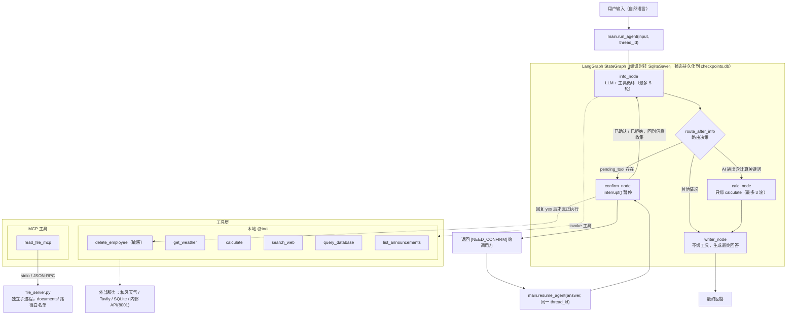

# multi-tool-agent

## 项目简介

一个用 **LangGraph** 编排的多工具 AI 助手：用自然语言提问，由 LLM 自主选择并调用天气、搜索、公司数据库、内部公告和 MCP 文件读取等工具，最后汇总成中文回答；**删除类敏感操作会强制暂停，等待人工确认后才执行**。

核心能力：

- **7 个工具**（6 个本地 `@tool` + 1 个 MCP 工具）：天气 / 计算 / 联网搜索 / 公司数据库 / 内部公告 API / 员工删除 / 文件读取
- **LangGraph StateGraph 编排**：`info → (calc)? → writer` 主链路，外加 `confirm` 敏感操作分支，取代传统的单 Agent ReAct 循环
- **MCP 协议接入**：文件读取走独立的 MCP Server（stdio / JSON-RPC），路径白名单在 Server 侧强制校验
- **权限控制**：基于 LangGraph `interrupt()` + SQLite checkpointer 实现"暂停—人工确认—跨进程恢复"
- **多轮工具循环**：`info_node` 最多 5 轮、`calc_node` 最多 3 轮，避免无限调用

## 架构图



## 工具列表

工具在 `tools/__init__.py` 中汇总为 `ALL_TOOLS`，并额外建立 `TOOL_MAP`（工具名 → 工具对象）供节点按名调用。

| 工具名 | 类型 | 用途 | 是否敏感 |
|---|---|---|---|
| `get_weather` | 本地 `@tool`（和风天气 HTTP API） | 查询指定城市的当前天气 | 否 |
| `calculate` | 本地 `@tool`（simpleeval） | 计算数学表达式，支持加减乘除、幂运算和括号 | 否 |
| `search_web` | 本地 `@tool`（Tavily） | 搜索互联网，返回与关键词相关的摘要 | 否 |
| `query_database` | 本地 `@tool`（SQLite 只读连接） | 查询公司数据库，返回员工信息；只允许 `SELECT`，最多返回 20 行 | 否 |
| `delete_employee` | 本地 `@tool`（SQLite 写入） | 删除指定 ID 的员工 | **是** |
| `list_announcements` | 本地 `@tool`（内部 API HTTP） | 查询公司内部公告，可按分类过滤（活动/运维/培训/财务） | 否 |
| `read_file_mcp` | **MCP 工具**（stdio → `file_server`） | 通过 MCP 协议读取 `documents/` 目录下的文件，支持 txt、md 等文本格式 | 否 |

`delete_employee` 的敏感性由 `agent/nodes.py` 中的 `SENSITIVE_TOOLS = {"delete_employee"}` 定义——命中该集合的 `tool_call` 不会被直接执行，而是交给 `confirm_node`。

## Agent 架构选型

### 为什么用 LangGraph 而不是 AgentExecutor

| 需求 | AgentExecutor | LangGraph StateGraph |
|---|---|---|
| 工具执行前暂停、等人工确认 | 只能在回调里中断，状态无法跨进程保存 | `interrupt()` 原生暂停，状态由 checkpointer 落盘 |
| 暂停后从**另一个进程**恢复 | 不支持 | `Command(resume=...)` + 相同 `thread_id` 即可恢复 |
| 不同阶段用不同工具集 | 一个 agent 只能绑一套工具 | 每个节点独立 `bind_tools` |
| 工具循环次数可控 | 靠 `max_iterations` 粗粒度限制 | 每个节点自己的 `for` 上限（5 / 3 轮） |

**取舍**：图的搭建和 state 管理比 `AgentExecutor` 重，需要自己维护 checkpointer；换来的是可恢复、可测试、每个节点能配独立的 prompt 和工具集。

### 为什么做职责分离（info / calc / writer）

三个节点绑定的工具集完全不同，这是分离的主要动机：

- `info_node` 绑 6 个信息类工具，负责"取数据"
- `calc_node` **只绑** `calculate`，避免选错工具
- `writer_node` **不绑任何工具**，只负责把已有信息写成通顺回答——它没有工具可调，因此不可能在最后一步又乱调工具

分工后每个 prompt 都很短（`agent/prompts.py` 共 47 行），职责聚焦。

**取舍**：一次问答会多出 1~2 次 LLM 调用，延迟和成本上升。更关键的是，`calc_node` 的**触发条件是脆弱的**——`route_after_info` 检查的是 **AI 自己最后一条消息**里有没有出现 `需要计算`、`帮我算` 等 6 个固定关键词，而不是检查用户问题。如果模型决定"我自己心算就行"而不说这句话，`calculate` 就永远不会被调用。20 任务实测中 **`calculate` 一次都没被调用过**，这是已知待优化项（见"已知限制"）。

### 为什么用 interrupt 实现敏感操作确认

关键点是：**把"要不要执行"的决定权从 LLM 手里拿走，交给代码**。

1. `info_node` 遍历 `tool_calls` 时，发现工具名在 `SENSITIVE_TOOLS` 里就**只记录不执行**，写入 `pending_tool`
2. `route_after_info` 看到 `pending_tool` 就路由到 `confirm_node`
3. `confirm_node` 调用 `interrupt(...)` 挂起，`run_agent` 向调用方返回 `[NEED_CONFIRM] ...`
4. 调用方回复后，`resume_agent(answer, thread_id)` 用**同一个 thread_id** 恢复
5. `answer == "yes"` 才真正执行，否则返回"用户取消了操作。"

这样做的好处是：**即使 LLM 被提示词说服（或被注入攻击诱导）要删除数据，只要没经过第 5 步就删不掉**。提示词里那句"你必须直接调用 `delete_employee`"只是让 LLM 正常发起请求，真正的闸门是代码。

**取舍**：调用方必须持有并复用**产生中断的那条 `thread_id`**，换线程就找不到中断状态（这一点在测试中踩过坑）；此外目前只判断 `yes`，没有超时和审计记录，生产环境还需要补上。

### 为什么用 MCP 而不是纯 `@tool`

`read_file_mcp` 的能力本身用 `open()` 也能实现，选择 MCP 是为了三件事：

1. **进程隔离**：文件读取跑在独立子进程里，崩溃不影响主 Agent
2. **安全边界在 Server 侧**：`file_server.py` 用 `ALLOWED_DIR = os.path.abspath("documents")` 做前缀校验，模型传 `../../etc/passwd` 也会被拒绝，而不是靠主进程自觉
3. **可复用**：同一个 Server 也能挂到 VS Code 等标准 MCP 客户端上，不必为每个宿主重写一遍

**取舍**：每次调用都要**启动子进程 + 协议握手**，首次调用有额外开销（实测约 1~3 秒，明显慢于本地 `@tool`）；而且 MCP Client 是异步的，在同步节点里只能用 `asyncio.run()` 桥接，在已有事件循环的环境中会冲突。

## 快速开始

### 环境准备

- **Python 3.11**（开发环境实测 3.11.7）
- 依赖已固化在根目录的 `requirements.txt`（由 `pip freeze` 生成，共 105 行，含全部间接依赖）：

```bash
python -m venv .venv
.venv\Scripts\activate          # Windows

pip install -r requirements.txt
```

如果之后升级了某个包，需要重新固化清单：

```bash
pip freeze > requirements.txt
```

开发环境中使用到的主要版本（供参考）：

| 包 | 版本 |
|---|---|
| langgraph | 1.2.12 |
| langgraph-checkpoint-sqlite | 3.1.1 |
| langchain-core | 1.6.6 |
| langchain-openai | 1.6.7 |
| mcp | 2.3.0 |
| fastapi | 0.142.4 |
| uvicorn | 0.54.0 |
| requests | 2.34.2 |
| python-dotenv | 1.2.3 |
| simpleeval | 1.0.8 |
| tavily-python | 0.8.4 |
| pydantic | 2.13.5 |

> ⚠️ **必须使用 MCP 2.x**。本项目依赖 mcp 的 v2 API，以下结论均在 `mcp==2.3.0` 上实测确认：
>
> - `python -c "from mcp.server import MCPServer; print('OK')"` → 输出 `OK`，实际解析到 `mcp.server.mcpserver.server.MCPServer`
> - `mcp.server.fastmcp` 在 2.x 中**只保留了一个故意抛错的占位模块**，导入会直接失败并给出迁移提示：
>   `ModuleNotFoundError: No module named 'mcp.server.fastmcp'. This is mcp 2.x, where FastMCP was renamed to MCPServer ... or pin 'mcp<2' to keep running v1 code.`
>
> `file_server.py` 用的是 `from mcp.server import MCPServer`，所以如果环境里装的是 `mcp<2`，启动 MCP Server 会立即报 `ImportError`（表现为任务 #6 / #17 读取文件全部失败）。可用 `pip show mcp` 确认版本。

### 配置 .env

在项目根目录创建 `.env`（**不要提交到版本库**），所有值用占位符替换：

```dotenv
# ---------- LLM（必填）----------
# 任意 OpenAI 兼容端点，例如 DeepSeek / 通义千问
LLM_BASE_URL=https://your-llm-endpoint/v1
LLM_API_KEY=sk-xxxxxxxxxxxxxxxx
LLM_MODEL=your-model-name

# ---------- 联网搜索（search_web 必填）----------
TAVILY_API_KEY=tvly-xxxxxxxxxxxxxxxx

# ---------- 天气（get_weather 必填）----------
HEFENG_API_HOST=your-subdomain.qweatherapi.com
HEFENG_API_KEY=xxxxxxxxxxxxxxxx

# ---------- 可选 ----------
# 思考模式：adaptive / enabled / disabled。默认 disabled。
# DeepSeek 思考模式会返回 reasoning_content，而 ChatOpenAI 不会把它回传，
# 多轮对话会偶发 400，因此默认关闭。
LLM_THINKING=disabled
# 内部 API 地址，默认 http://localhost:8001
INTERNAL_API_BASE=http://localhost:8001
```

代码实际读取的环境变量只有上面这些。`.env` 里另外还声明了 `LLM_PROVIDER`、`QWEN_BASE_URL`、`QWEN_MODEL`、`DASHSCOPE_API_KEY`，但**当前代码没有任何地方读取它们**，属于历史遗留，可以删除。

### 初始化数据库

`scripts/` 下的初始化脚本文件名有个拼写错误，是 **`inint_db.py`**（不是 `init_db.py`）：

```bash
python scripts/inint_db.py
# 输出：数据库创建完成：data/company.db
```

该脚本会**重建** `employees` 表并写入 7 名员工（张三、李四、王五、赵六、孙七、周八、吴九）。

> 注意：仓库里现存的 `data/company.db` 只有 **6 行**（`id=5` 的"孙七"已被此前的删除测试移除），`data/company_backup.db` 与之一致，被 `test_20_tasks.py` 当作"纯净副本"在每次测试前还原。如果你重新跑了 `inint_db.py`，数据库会回到 7 行；这不影响 20 任务测试的判定关键词（技术部仍是张三/李四/周八 3 人）。

### 启动内部 API

公告查询工具依赖这个服务，**必须先启动**（端口 8001）：

```bash
uvicorn internal_api.server:app --port 8001
```

它提供 3 个接口：`GET /health`、`GET /announcements?limit=&category=`、`GET /announcements/{id}`。
可用浏览器或 `curl http://localhost:8001/health` 确认返回 `{"status":"ok"}`。

### 运行 Agent

```bash
python main.py
```

`main.py` 的 `__main__` 会跑一个示例问题（查询南昌天气）并打印回答。

作为库调用时，对外只有两个函数：

```python
from main import CONFIRM_PREFIX, resume_agent, run_agent

answer = run_agent("北京今天天气怎么样？", thread_id="demo")
if answer.startswith(CONFIRM_PREFIX):
    # 敏感操作，需要人工确认
    print(answer)                     # [NEED_CONFIRM] 即将执行敏感操作：...
    answer = resume_agent("yes", thread_id="demo")   # thread_id 必须一致
print(answer)
```

### 可选：在 VS Code 里通过 MCP 连接 file_server

`file_server.py` 是标准 stdio MCP Server，可以直接挂到 VS Code 的 `.vscode/mcp.json`：

```json
{
  "servers": {
    "file-reader": {
      "type": "stdio",
      "command": "${workspaceFolder}/.venv/Scripts/python.exe",
      "args": ["${workspaceFolder}/mcp_servers/file_server.py"],
      "cwd": "${workspaceFolder}"
    }
  }
}
```

**`cwd` 不能省**：`file_server.py` 里的 `ALLOWED_DIR = os.path.abspath("documents")` 是相对**当前工作目录**解析的，工作目录不对会导致路径白名单指向错误的位置。（配置格式依据 [VS Code MCP configuration reference](https://code.visualstudio.com/docs/agents/reference/mcp-configuration)：`.vscode/mcp.json` 使用顶层 `servers` 对象，stdio 服务支持 `command` / `args` / `cwd`，并支持 `${workspaceFolder}` 变量。）

## 故障排查

按「报错信息 → 原因 → 解决方法」整理。以下 7 条都是本项目开发和测试过程中**真实出现过**的问题。

### 1. `ModuleNotFoundError: No module named 'mcp.server.fastmcp'`

**症状**：任务 #6 / #17（读取文件）全部失败，或直接运行 `python mcp_servers/file_server.py` 时抛错：

```text
ModuleNotFoundError: No module named 'mcp.server.fastmcp'. This is mcp 2.x,
where FastMCP was renamed to MCPServer ... or pin 'mcp<2' to keep running v1 code.
```

**原因**：环境里装的是 `mcp<2`（v1 API），而 `file_server.py` 用的是 v2 的 `from mcp.server import MCPServer`。

**解决**：

```bash
pip show mcp        # 期望 Version: 2.3.0
python -c "from mcp.server import MCPServer; print('OK')"   # 期望输出 OK
pip install -r requirements.txt    # 版本不对就按清单重装
```

### 2. `错误：无法连接内部 API（http://localhost:8001）`

**症状**：`list_announcements` 返回"请确认服务已启动"。

**原因**：内部 API 是**独立进程**，Agent 不会自动拉起它。

**解决**：

```bash
uvicorn internal_api.server:app --port 8001
curl http://localhost:8001/health     # 期望 {"status":"ok"}
```

### 3. 启动内部 API 报 `[Errno 10048] error while attempting to bind on address ('127.0.0.1', 8001)`

**原因**：端口被占用——**很可能已经有一个实例在跑**，不需要再起一个。

**解决**：先探测再决定；确实要换端口，记得同步改 `.env`：

```bash
curl http://localhost:8001/health     # 有响应 → 已在运行，直接用即可
uvicorn internal_api.server:app --port 8002
# 同时设置 INTERNAL_API_BASE=http://localhost:8002
```

> 提示：`Get-NetTCPConnection -LocalPort 8001` 在部分环境下会返回空结果，用 HTTP 探测更可靠。

### 4. 敏感操作无法恢复：`resume_agent` 像重新开了一轮对话

**原因**：`thread_id` 与首次调用不一致。中断现场是按 `thread_id` 存进 `checkpoints.db` 的，换一个 id 就找不到。

**解决**：两次调用必须是**同一个** `thread_id`：

```python
answer = run_agent("帮我删掉 ID 为 7 的员工", thread_id="t1")
if answer.startswith(CONFIRM_PREFIX):
    answer = resume_agent("yes", thread_id="t1")   # 必须是 t1，不能换
```

### 5. 偶发 400：`The 'reasoning_content' in the thinking mode must be passed back to the API`

**原因**：DeepSeek 的思考模式会返回 `reasoning_content`，而 `ChatOpenAI` 不会把它回传；一次问答里存在多次 LLM 调用时就会偶发 400，表现为某个任务直接抛异常挂掉。

**解决**：关闭思考模式（`llm_client.py` 的默认值就是关闭）：

```dotenv
LLM_THINKING=disabled
```

### 6. 读取文件报 `文件不存在 documents/test.txt`

**原因**：`read_file` 的 `path` 参数是**相对 `documents/`** 的，不是相对项目根目录。传 `documents/test.txt` 会被拼成 `documents/documents/test.txt`。

实测行为对照：

| 传入 `path` | 结果 |
|---|---|
| `test.txt` | ✅ 返回 `Hello from MCP!` |
| `documents/test.txt` | ❌ 错误：文件不存在 documents/test.txt |
| `../test.txt` | ❌ 错误：不允许访问 `../test.txt`，只能读取 documents/ 目录下的文件。 |
| `sub/../test.txt` | ✅ 归一化后仍在白名单内，正常读取 |

**解决**：只传相对 `documents/` 的路径，例如 `test.txt`。

### 7. `unable to open database file` / 找不到 `documents/`

**原因**：`tools/database.py` 的 `DB_PATH = "data/company.db"` 和 `file_server.py` 的 `ALLOWED_DIR = os.path.abspath("documents")` 都是**相对当前工作目录**解析的，换目录运行就会失效。

**解决**：始终在**项目根目录**下运行（`test_20_tasks.py` 已内置 `os.chdir(PROJECT_ROOT)` 自动兜底）；在 VS Code 里挂 MCP Server 时，务必显式配置 `cwd`。

## 测试结果

`test_20_tasks.py` 覆盖 20 个任务（单工具 / 多工具 / 敏感操作 / 边界 / 多步推理 / 综合），逐条判定并生成报告。

| 指标 | 结果 |
|---|---|
| **完成率** | **87.5%**（目标 ≥ 70%） |
| 成功 / 部分成功 / 失败 | 16 / 3 / 1 |
| 语义放宽判定（不计入主判定） | 97.5%（19 / 1 / 0） |
| 总耗时 | 79.4s，平均 4.0s/任务 |

按类别：

| 类别 | 完成率 | ✅ | ⚠️ | ❌ | 合计 |
|---|---|---|---|---|---|
| 单工具 | 100% | 6 | 0 | 0 | 6 |
| 多工具 | 90% | 4 | 1 | 0 | 5 |
| 敏感操作 | 100% | 3 | 0 | 0 | 3 |
| 边界 | 50% | 1 | 2 | 1 | 4 |
| 多步推理 | 100% | 1 | 0 | 0 | 1 |
| 综合 | 100% | 1 | 0 | 0 | 1 |

判定公式：`完成率 = (✅ + 0.5 × ⚠️) / 20`；单个任务命中 ≥80% 预期关键词记为 ✅，≥50% 记为 ⚠️。

已知失败项及原因：

| # | 任务 | 状态 | 原因 |
|---|---|---|---|
| 8 | 技术部有多少人？平均薪资是多少？ | ⚠️ | 工具调用正确（`query_database` + `calculate`，表达式 `(25000+28000+35000)/3`），但回答里的中间算式**写错了**——"25000 + 28000 + 35000 = **88,333**"（正确是 88,000）；最终值又用了千分位 `29,333.33`，未命中关键词 `29333` |
| 15 | 查一下火星的天气 | ⚠️ | 已正确拒答（说明天气接口只覆盖地球城市、火星不在库里），但命中 `无法` / `火星`、缺关键词 `不支持` |
| 16 | 帮我算 10/0 | ❌ | 回答正确（说明 10÷0 无定义、Python 会抛 `ZeroDivisionError`），但关键词 `zero` **区分大小写**，`ZeroDivisionError` 未命中；同时 `calculate` 未被调用 |
| 18 | 今天股票行情怎么样？ | ⚠️ | 已按实时数据约束补充说明（"无法确认是否为最新实时行情，请以行情软件为准"），但仍列出了网页快照里的指数表格，缺关键词 `不支持` |

其中 #15 / #16 属于**关键词表过严**（答案本身是对的）；#8 暴露了一个新问题——**工具算对了，但 LLM 在叙述里把中间算式写错**；#18 在补充实时数据约束后由 ❌ 升为 ⚠️，但仍是部分成功。完整报告见 [`test_20_tasks_result.md`](test_20_tasks_result.md)。

## 调用日志

日志由 `utils/logger.py` 统一配置：`INFO` 及以上同时写入 `logs/agent.log`（UTF-8）和 `stderr`，格式为

```
%(asctime)s | %(levelname)-7s | %(name)s | %(message)s
```

时间格式 `%Y-%m-%d %H:%M:%S`。各字段含义：时间戳 | 日志级别（左对齐补到 7 字符）| logger 名称 | 消息。`logger` 名称能直接看出执行阶段——`main` 是入口、`agent.nodes` 是图节点、`httpx2` 是底层 HTTP 请求。

`logs/agent.log` 中的真实样例：

```text
2026-10-08 10:20:32 | INFO    | agent.nodes | [info_node] 调用工具: get_weather, 参数: {'city': '南昌'}
2026-10-08 10:20:35 | INFO    | agent.nodes | [info_node] 工具结果: 南昌：晴，温度 23℃，体感 23℃，湿度 49%, 耗时: 2.86s
2026-10-08 10:44:51 | WARNING | agent.nodes | [info_node] 敏感操作，等待用户确认: delete_employee
2026-10-08 10:44:51 | WARNING | main | [run_agent] 触发中断: 即将执行敏感操作：delete_employee，参数：{'employee_id': 7}。确认吗？(yes/no)
2026-10-08 10:51:54 | INFO    | main | [run_agent] 返回回答: **结论：技术部平均薪资比市场部高 9,333.33 元。**
```

排查思路：想看**调了哪些工具**搜 `调用工具`；想看**工具返回了什么**搜 `工具结果`；想看**敏感操作**搜 `敏感操作` / `触发中断`。

## 目录结构

```
multi-tool-agent/
├── main.py                  # 对外唯一入口：run_agent / resume_agent，屏蔽 LangGraph 细节
├── llm_client.py            # LLM 单例（ChatOpenAI），集中处理 base_url/思考模式等配置
├── agent/                   # LangGraph 图定义
│   ├── graph.py             # StateGraph 组装、条件路由 route_after_info、SqliteSaver 编译
│   ├── nodes.py             # 4 个节点：info / calc / writer / confirm，工具集在此绑定
│   ├── prompts.py           # 各节点独立的系统提示词
│   └── state.py             # State 定义：messages / pending_tool / needs_calc
├── tools/                   # 本地 LangChain 工具（@tool）
│   ├── __init__.py          # 汇总 ALL_TOOLS 并建立 TOOL_MAP
│   ├── weather.py           # get_weather：和风天气 HTTP API
│   ├── calculator.py        # calculate：simpleeval 求值
│   ├── search.py            # search_web：Tavily 搜索
│   ├── database.py          # query_database：SQLite 只读查询（强制 SELECT）
│   ├── database_admin.py    # delete_employee：SQLite 删除（敏感操作）
│   ├── internal_api.py      # list_announcements：调用内部 API（端口 8001）
│   └── mcp_bridge.py        # read_file_mcp：把 MCP 工具包装成普通 @tool
├── mcp_servers/             # MCP 服务端与客户端
│   ├── file_server.py       # MCP Server：暴露 read_file，documents/ 路径白名单
│   └── client.py            # MCP Client：stdio 启动 Server 并调用（带 30s 超时）
├── internal_api/
│   └── server.py            # FastAPI 模拟公司内部系统，提供公告接口
├── utils/
│   └── logger.py            # 统一日志配置（文件 + stderr，INFO 级）
├── scripts/
│   └── inint_db.py          # 重建并填充 employees 表（注意文件名拼写）
├── data/
│   ├── company.db           # SQLite 公司员工库
│   └── company_backup.db    # 纯净副本，测试前还原用
├── documents/
│   └── test.txt             # MCP 读取用的示例文件
├── logs/
│   └── agent.log            # 运行日志（追加写入）
├── checkpoints.db           # LangGraph 状态快照，支撑中断/恢复
├── requirements.txt         # 依赖清单（pip freeze 生成，启用环境时用 -r 安装）
├── test_20_tasks.py         # 20 任务评测脚本
└── test_20_tasks_result.md  # 评测报告
```

## 已知限制

**明确不做的**：

- **流式输出**：当前是同步 `invoke`，回答一次性返回。接入流式需要改造 `main.py` 的返回方式和各节点的调用方式，属于可选增强。
- **Redis / Qdrant**：本项目**没有向量检索或分布式缓存需求**，已确认代码中不存在任何 Qdrant / Redis 依赖与配置，无需部署这两个组件。

**待优化**：

- **边界任务偏弱**（当前 50%，已从 25% 改善）：`INFO_AGENT_PROMPT` 里补的实时数据约束已见效——#18 不再把过期快照当"今天"播报，而是主动声明"无法确认是否为最新实时行情"。但 Agent 仍会先列出网页快照数据，还没做到"没有对应工具就直接拒答"。
- **`calculate` 的触发不可靠**：`route_after_info` 依赖 AI 自己输出里出现 `需要计算` / `帮我算` 等固定关键词才进入 `calc_node`，模型一句"这不用调工具"就能绕过整个计算器。多次完整跑测中，4 个计算类任务通常**一个都触发不到** `calculate`；最近一次运行只有 #8 触发（表达式正确），#2 / #16 / #20 仍由 LLM 心算完成。建议改为同时检测**用户提问**中的算术意图，或让 `calc_node` 无条件执行。
- **日志无轮转**：`utils/logger.py` 用的是普通 `FileHandler`，没有 `RotatingFileHandler`，`logs/agent.log` 会无限增长（目前已 170KB+）。
- **MCP 连接未复用**：`mcp_bridge.py` 每次调用都 `asyncio.run(call_read_file(...))`，意味着**每次都重新启动一次 MCP Server 子进程并握手**，单次约 1~3 秒。长会话下建议保持长连接。
- **关键词判定过严**：评测脚本的部分关键词要求字面同时出现所有同义词（如"错误"+"除零"+`zero`），会导致正确答案被判为 ⚠️/❌；脚本已额外提供一套语义放宽判定作为对照。
- **`scripts/inint_db.py` 文件名拼写错误**：应为 `init_db.py`。（`agent/__init__.py` 先前曾误写为 `__init.py`，**现已修正**；顺带说明，该拼写错误本身并不影响导入——Python 3.3+ 的命名空间包机制下 `import agent.graph` 照常工作。）

## 下一步计划

按优先级排列（P0 最高）。每项都注明**现状依据**和**验收方式**，避免"感觉修好了"。

### P0 — 修复 `calc_node` 触发条件

**现状**：`route_after_info` 判断的是 **AI 自己最后一条消息**里有没有出现 `需要计算` / `帮我算` 等 6 个固定关键词，而不是判断用户的提问。只要模型说一句"这不用调工具"，`calc_node` 就被整个绕过。多次实测中 4 个计算类任务（#2 / #8 / #16 / #20）通常**全部由 LLM 心算完成**；最近一次运行只有 #8 真正调用了 `calculate`，其余三个仍未触发。工具是可达的，**但路由不可靠**。

**改法**（二选一或叠加）：

1. 在 `route_after_info` 里**同时检查用户提问**（最近一条 `HumanMessage`）是否含数字与运算符等算术意图；
2. 让 `calc_node` 在数据收集完成后**无条件执行一次**，由 `calculate` 工具统一承担算术。

**验收**：重跑 `python test_20_tasks.py`，任务 #2 / #16 的工具轨迹里必须出现 `calculate`。

### P1 — 收敛边界任务（当前 50%，已从 25% 改善）

**现状**：在 `INFO_AGENT_PROMPT` 里补充"实时数据不得编造、查不到就明说"的约束后，#18 已从 ❌ 升为 ⚠️——不再把 9 月 30 日的快照当"今天"播报，会主动声明"无法确认是否为最新实时行情"。但它仍会先列出快照表格，没有直接拒答。

**改法**：把约束再往前推一步——没有对应工具时**先声明无法回答**，而不是"先给数据再补免责声明"；或在路由层对交易/实时行情类问题直接拦截。

**验收**：任务 #18 达到 ✅（而不是靠免责声明拿 ⚠️）。

### P2 — 日志轮转

`utils/logger.py` 用的是普通 `FileHandler`，`logs/agent.log` 只增不减（目前已 170KB+）。改为 `RotatingFileHandler(maxBytes=..., backupCount=...)`。

### P2 — MCP 连接复用

`mcp_bridge.py` 每次调用都 `asyncio.run(call_read_file(...))`，等于**每次都重启一次 MCP Server 子进程并握手**（单次约 1~3 秒）。改为长连接后，连续读取多个文件能显著提速。

### P3 — 评测脚本改进

- 关键词放宽：`29333` 应能匹配 `29,333.33`（千分位），`zero` 应忽略大小写（当前 `ZeroDivisionError` 不命中）
- 为每个任务增加"预期工具"断言，把"答案对但工具没调"的情况单独标记，而不是算作 ✅

### P3 — 清理历史遗留

- 删除 `.env` 中代码从不读取的 `LLM_PROVIDER` / `QWEN_BASE_URL` / `QWEN_MODEL` / `DASHSCOPE_API_KEY`
- `scripts/inint_db.py` 改名为 `init_db.py`（注意同步 README 与文档引用）

### P4 — 可选增强

- **流式输出**：当前是同步 `invoke`，回答一次性返回
- **敏感操作超时与审计**：目前是无限等待 + 只判断 `yes`，缺少超时与操作记录

## License

MIT
